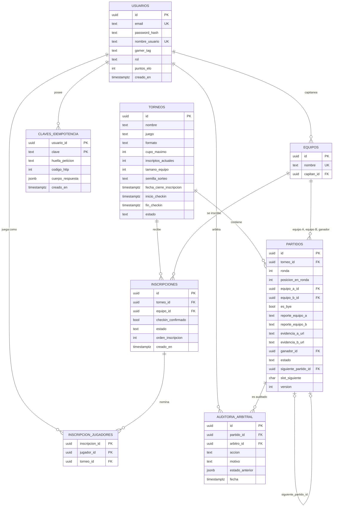
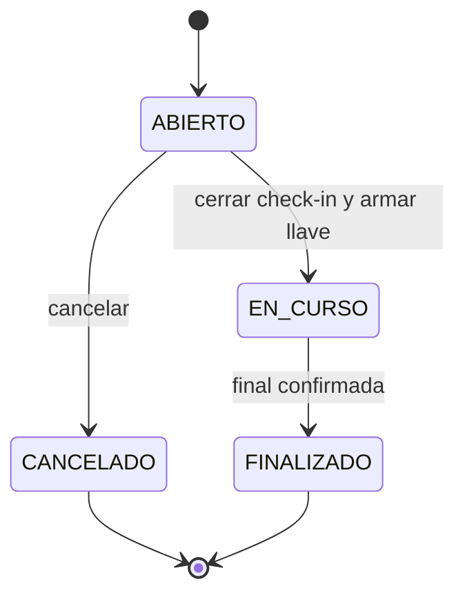
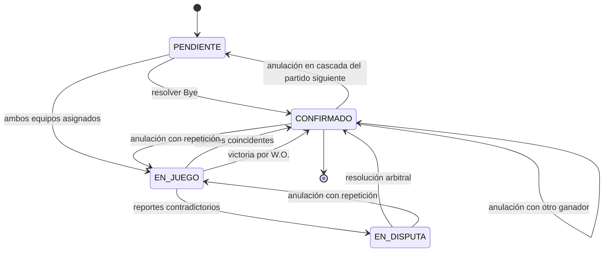
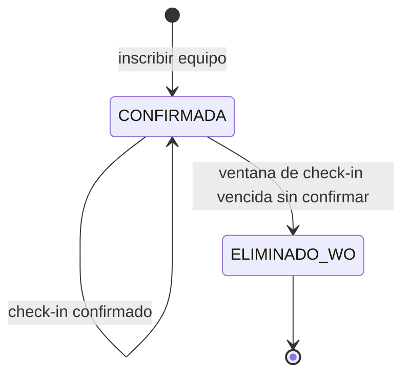

# Modelo de datos y máquinas de estado

Formato de torneo soportado: eliminación simple (alcance reducido declarado en el README).

## Diagrama entidad-relación

## Invariantes garantizadas por la base de datos

| Invariante | Mecanismo |
| --- | --- |
| Nunca hay más inscriptos que cupos | `CHECK inscriptos_actuales <= cupo_maximo` y `SELECT ... FOR UPDATE` sobre el torneo |
| Un equipo se inscribe una sola vez por torneo | `UNIQUE (torneo_id, equipo_id)` |
| Un jugador juega en un solo equipo por torneo | `UNIQUE (torneo_id, jugador_id)` en `inscripcion_jugadores` |
| El orden de inscripción no se repite | `UNIQUE (torneo_id, orden_inscripcion)` |
| Un lugar de la llave es único | `UNIQUE (torneo_id, ronda, posicion_en_ronda)` |
| El puntero al siguiente partido está completo o ausente | `CHECK ((siguiente_partido_id IS NULL) = (slot_siguiente IS NULL))` |
| Estados y reportes válidos | `CHECK` sobre `estado`, `rol`, `reporte_equipo_*`, `slot_siguiente` |
| La ventana de check-in es coherente | `CHECK fin_checkin > inicio_checkin` |
| No se borra información referenciada | `ON DELETE RESTRICT` en todas las claves foráneas |
| Una clave de idempotencia es única por usuario | `PRIMARY KEY (usuario_id, clave)` |

Las operaciones de escritura sobre torneo y partidos se hacen dentro de una transacción con bloqueo pesimista; el orden de bloqueo es partidos de menor a mayor ronda y luego torneo (ADR 0002 y ADR 0004). La columna `version` de `partidos` se incrementa en cada modificación.

## Máquina de estados del torneo

- Solo `ABIERTO` acepta inscripciones y check-in.
- Solo `ABIERTO` puede iniciarse o cancelarse.
- Solo `EN_CURSO` puede finalizarse, y exige que el partido final esté `CONFIRMADO` con ganador.

## Máquina de estados del partido

- `registrarReporte` solo se acepta en `EN_JUEGO`; `resolverDisputaArbitral` solo en `EN_DISPUTA`.
- Las anulaciones (`CONFIRMADO` o `EN_DISPUTA`) las hace un árbitro con motivo obligatorio y dejan una fila en `auditoria_arbitral` con el estado anterior.
- Un Bye no se puede anular.
- Si la anulación cambia el ganador, el partido siguiente vuelve a `PENDIENTE` y la reversión se propaga en cascada hacia la final (ADR 0006).
- Cualquier transición fuera de este diagrama lanza `PartidoNoModificableError`.

## Máquina de estados de la inscripción

Una inscripción `ELIMINADO_WO` no puede tener `checkin_confirmado = true`. Los equipos eliminados por W.O. no entran a la llave y liberan su lugar con Byes.
